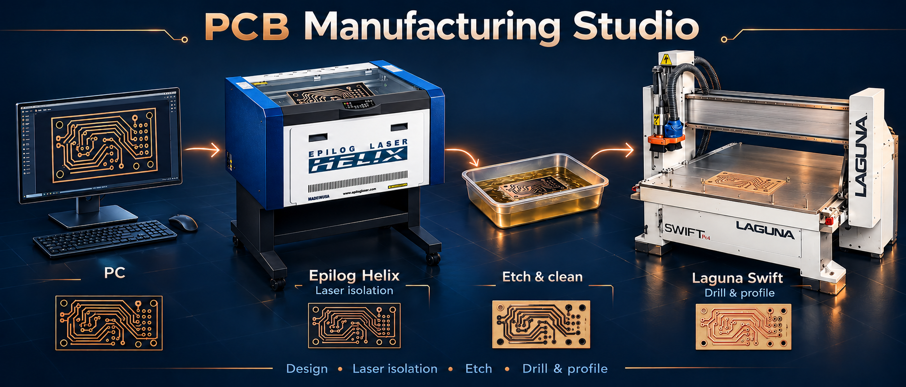
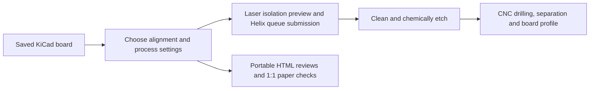
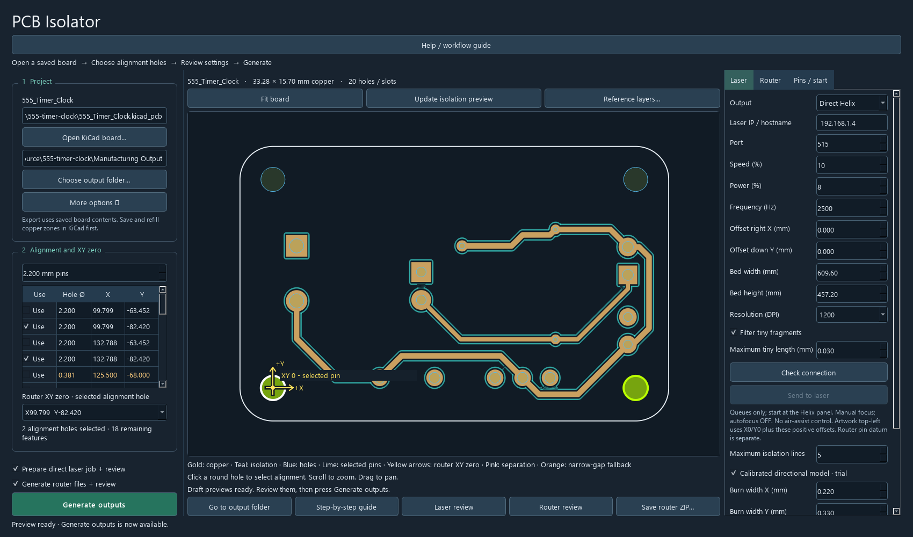
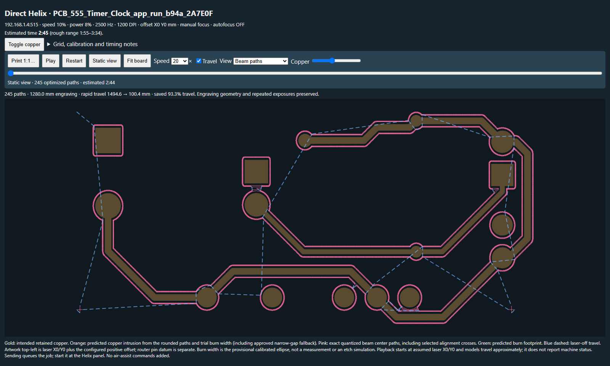
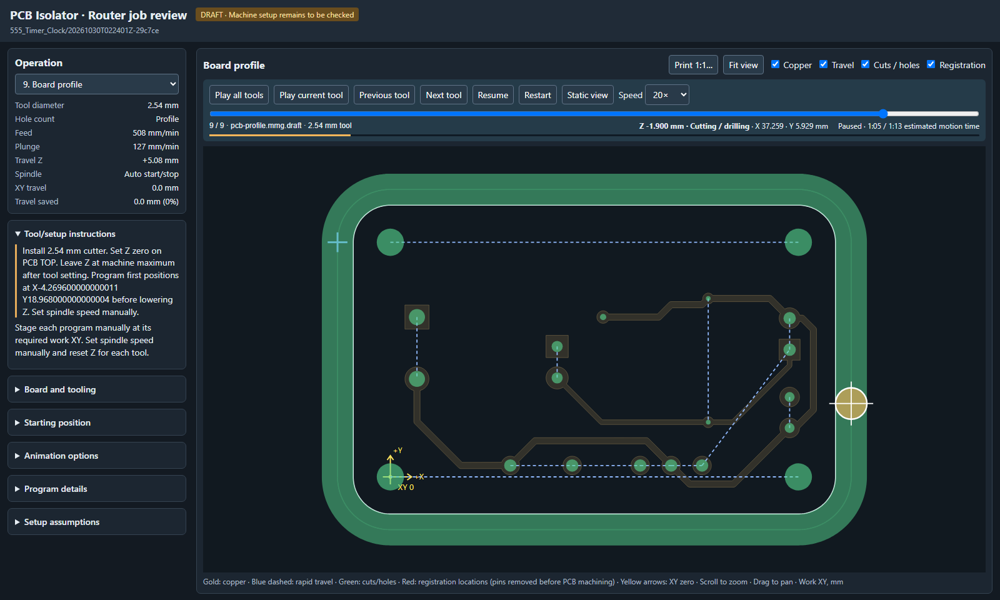
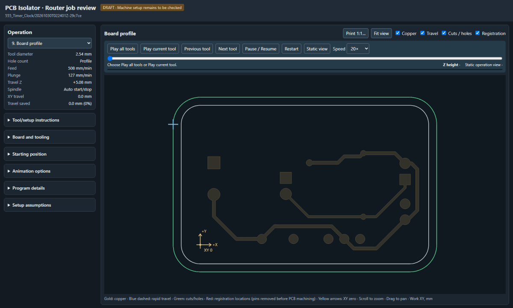

# PCB Manufacturing Studio



**Laser isolation, CNC drilling and board routing in one Windows app.**

The application is currently named **PCB Isolator**. It turns a saved KiCad board
into reviewed manufacturing files for a painted-copper, laser-and-etch workflow,
then prepares drilling and profile programs for a CNC router.

This is the **0.3.0-rc.1 single-sided milestone**, developed around an Epilog Helix
and Laguna Swift. A real single-sided board has been completed during development.
It is not a general-purpose CAM system or a verified driver for arbitrary machines.



## See it in action

The main workspace, laser paths and CNC review from a small, openly licensed 555 timer example:



| Laser isolation review | CNC router review |
| --- | --- |
|  |  |

**All router tools, in sequence — accelerated playback:**



The sample design is by Franz Louis Vigilar, MIT licensed. These captures show B.Cu from a two-sided source board. No hardware job was sent for this demonstration. The header is conceptual artwork; [asset credits and source details](docs/media/README.md).

## What it does

- Imports the saved B.Cu artwork, round drills, outline and optional CNC Separation layer.
- Plans multiple isolation lanes with trial directional burn-width compensation,
  adaptive spacing, narrow-gap handling and visible small-fragment decisions.
- Prepares direct Helix jobs, checks connectivity, shows transfer progress and waits
  for queue acknowledgement. **Sending does not start the laser.**
- Optimizes actual laser path order and animates the exact prepared device-grid paths.
- Groups drill sizes into available tools; generates one MMG file per tool with peck
  drilling, rapid approach, separation cuts and outside profiling last.
- Uses selected alignment holes as registration and the router XY datum. Locate the
  board with pins, press the tape, then **remove pins before PCB machining**.
- Provides router animation, a step-by-step guide, 1:1 paper inspection and shareable
  router-review ZIPs. Reviews embed their drawing and animation data.
- Lets you inspect other saved KiCad layers on the main view. These references are
  display-only; they never change generated manufacturing geometry.

## Try the Windows app

Download the Windows x64 portable ZIP from this repository's Releases page,
extract the **entire** archive, and run `PCB Isolator.exe`. Keep `_internal` next to it.
Python, Qt, geometry libraries and a private Java/LibLaserCut encoder are bundled.
No separate Python, Java or VS Code installation is needed on the laptop.
KiCad 8/9 is required separately to export a saved board or plot uncached reference
layers; KiCad 9 was used during development.

1. Save and refill copper zones in KiCad, then open the board in the app.
2. Choose registration holes, router XY zero, tools and laser settings.
3. Generate and inspect the previews; then generate outputs or explicitly send the
   reviewed laser job. Transfer the MMG files separately to the CNC controller.

See [workflow and settings](docs/workflow.md) and the app's Help button. The synthetic
[example job](examples/synthetic-job/README.md) is for offline exploration only.
Do not run demo files on hardware.

## Current boundaries

- Single-sided **B.Cu** manufacturing; seeing other copper layers does not enable
  double-sided or internal-layer manufacturing.
- Epilog Helix Ethernet queue submission and a Laguna-specific MMG workflow.
  Focus, spindle speed, air and exhaust are manual. The app does not drive the CNC
  in real time or confirm that a queued laser job has physically finished.
- Trial process calibration, not guaranteed minimum trace/clearance capability.
  Tool fit, material, workholding and controller modes need actual verification.
- Slot machining is not implemented. Internal cutouts can need a smaller cutter or
  an explicit omission; the outside profile cannot simply be ignored.
- SVG/DXF engines remain available in the source, but their desktop delivery controls
  are currently paused while direct printing is the normal laser path.

## Develop, test and build

Use Python 3.12 on Windows for the tested build. From the project root:

```powershell
./tools/bootstrap.ps1
./start-app.cmd
./.venv/Scripts/python.exe -m pytest -q
./packaging/build-portable.ps1
```

Bootstrap installs pinned dependencies, copies the example CLI configuration only
if needed, and prepares the pinned Java helper/runtime. It may download a verified
JDK if no suitable JDK is supplied. See [development and packaging](docs/development.md).

## Source map

| Location | Purpose |
|---|---|
| `src/pcb_isolator/` | Desktop UI, geometry, manufacturing and review engines |
| `tests/` | Synthetic geometry, workflow, export, UI and mock-transfer checks |
| `helix/src/` | Small app-owned offline Java bridge |
| `helix/LibLaserCut-source/` | Pinned, unmodified upstream LGPL source |
| `packaging/` | Portable build and dependency-license collection |
| `docs/` | Workflow, design, process evidence, history and roadmap |
| `examples/` | Synthetic data, not personal PCB designs |

Local board designs, original macro photos, machine settings, old experiments,
transmission records and preservation archives are intentionally **not published**.
No development data was deleted to prepare this repository.

## History, credits and license

Development began on **18 October 2026**, driven by Emil Andersson's manufacturing
workflow and iterative AI-assisted development with OpenAI Codex. The progression
from Gerber/DXF experiments to direct printing and a completed board is recorded in
[history](docs/history.md). This application is **not a FlatCAM fork**.

Original app code is [MIT licensed](LICENSE). Bundled/vendored third-party code keeps
its own licenses. See [third-party sources and attribution](THIRD-PARTY-NOTICES.md),
[calibration evidence and limits](docs/calibration.md), and [roadmap](docs/roadmap.md).
